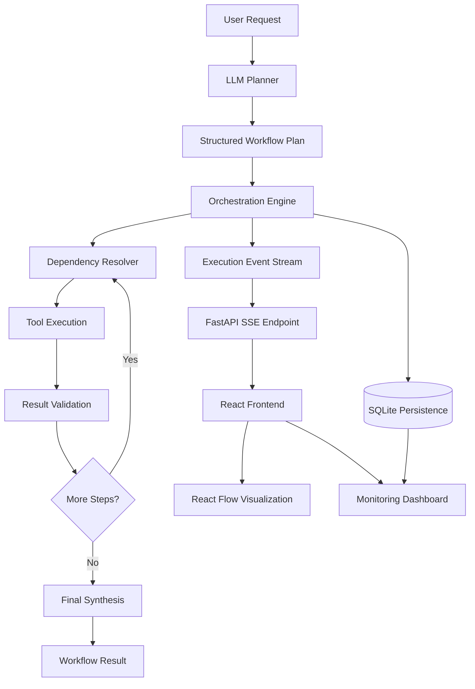
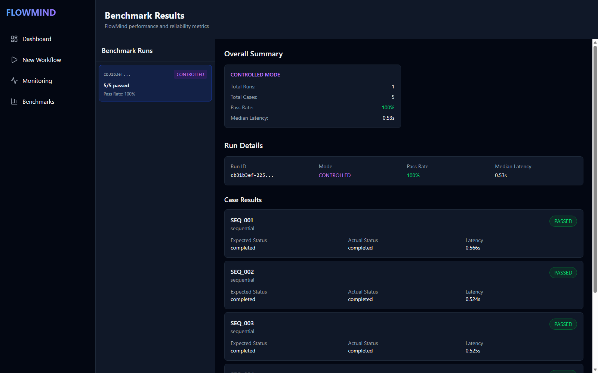

# FlowMind — AI Workflow Orchestration Platform

FlowMind is an AI workflow orchestration platform that transforms natural-language requests into structured, executable workflows. It combines LLM-powered planning, tool execution, dependency-aware scheduling, failure handling, and real-time monitoring to make AI workflows more observable and manageable.

The platform explores the engineering foundations required to build reliable AI systems beyond simple prompt-response interactions.

## Key Features

### 1. LLM-Powered Workflow Planning
- Converts natural-language requests into structured execution plans.
- Selects appropriate tools for individual tasks.
- Supports multi-step workflows with explicit dependencies.
- Passes intermediate results between dependent steps.

### 2. Dependency-Aware Orchestration
- Executes sequential and independent tasks.
- Supports parallel execution where dependencies permit.
- Resolves scalar and structured tool outputs.
- Tracks step-level execution states and dependencies.

### 3. Reliability and Failure Handling
- Implements retry mechanisms for transient failures.
- Classifies execution errors.
- Handles empty results and blocked dependencies.
- Supports partial workflow completion.
- Persists workflow states to maintain consistent execution records.

### 4. Real-Time Execution Monitoring
- Streams workflow events using Server-Sent Events (SSE).
- Tracks planner activity, tool execution, step completion, and failures.
- Provides visibility into workflow progress and final results.

### 5. Interactive Workflow Visualization
- Uses React Flow to visualize workflow steps and dependencies.
- Displays step-level execution states.
- Helps identify failed, completed, and blocked operations.

### 6. Benchmarking and Evaluation
- Includes a benchmark framework for evaluating workflow execution.
- Supports controlled execution with deterministic fixtures and live-provider testing.
- Measures workflow completion, expected-behavior pass rate, output correctness, latency, and failure recovery.
- Generates JSON and Markdown benchmark reports.

## Architecture



The architecture separates planning, execution, persistence, and visualization so that workflow behavior can be monitored and evaluated independently.

## Screenshots

These screenshots use synthetic workflow and controlled-benchmark data.




## Technology Stack

| Layer | Technologies |
|---|---|
| Frontend | React, TypeScript |
| Workflow visualization | React Flow |
| Backend | Python, FastAPI |
| AI integration | Groq, Google Gemini |
| Communication | REST APIs, Server-Sent Events |
| Persistence | SQLite, SQLAlchemy |
| Benchmarking | Python, pytest, JSON and Markdown reports |
| Containerization | Docker, Docker Compose |

## Project Structure

```text
FlowMind/
├── backend/
│   ├── app/
│   │   ├── agents/
│   │   ├── api/
│   │   ├── benchmarks/
│   │   ├── models/
│   │   ├── orchestrator/
│   │   ├── persistence/
│   │   ├── providers/
│   │   └── tools/
│   ├── tests/
│   └── benchmark_reports/
├── frontend/
│   └── src/
│       ├── pages/
│       └── ...
├── docker-compose.yml
└── README.md
```

*Directory names may vary slightly depending on the current repository structure.*

## Getting Started

### Prerequisites

- Python 3.12 or newer
- Node.js 20.19+ or 22.12+ and npm
- Docker and Docker Compose (for containerized execution)
- A Groq or Gemini API key to run LLM-backed workflows (the app can start without one)

### 1. Clone the repository

```bash
git clone <YOUR_GITHUB_REPOSITORY_URL>
cd FlowMind
```

### 2. Configure environment variables

To enable LLM-backed workflows, copy the backend environment example and add a key for the selected provider. The app and Docker Compose can also start without an API key, but workflow requests that need an LLM will fail until one is configured.

```powershell
Copy-Item backend\.env.example backend\.env
```

On macOS/Linux:

```bash
cp backend/.env.example backend/.env
```

Set `LLM_PROVIDER` to `groq` or `gemini`, then configure the matching `GROQ_API_KEY` or `GEMINI_API_KEY`. For example:

```dotenv
LLM_PROVIDER=groq
GROQ_API_KEY=your-groq-api-key
```

Model names, `MAX_AGENT_STEPS`, and `DB_URL` can also be set in the environment. See [`backend/.env.example`](backend/.env.example) for the available settings. Keep API keys and credentials in your local `.env` file; never commit it.

### 3. Start the application

From the project root:

```bash
docker compose up --build
```

The API is available at <http://localhost:8000> and <http://localhost:8000/health>; the frontend is at <http://localhost:3000>. Compose waits for the backend health check before starting the frontend. The database is stored in a persistent Docker volume.

To run the backend locally, then start the frontend in a second terminal:

```powershell
cd backend
python -m venv .venv
.venv\Scripts\python.exe -m pip install -r requirements.txt
.venv\Scripts\python.exe -m uvicorn app.main:app --reload --port 8000
```

On macOS/Linux:

```bash
cd backend
python3 -m venv .venv
source .venv/bin/activate
python -m pip install -r requirements.txt
python -m uvicorn app.main:app --reload --port 8000
```

```bash
cd frontend
npm ci
npm run dev
```

Open <http://localhost:5173>. The Vite development server proxies `/api` requests to the local backend.

## Benchmarking

FlowMind includes a benchmark framework for evaluating orchestration behavior under controlled and live execution conditions.

### Controlled benchmark

Uses predefined workflow plans and mocked external responses to evaluate execution behavior without depending on live provider availability.

```bash
cd backend
python -m app.benchmarks.run --mode controlled
```

A local controlled sequential run completed **5/5 cases** with **0 failures**
and a **0.53 s median latency**. This is one deterministic sample run, not a
general performance guarantee; results vary by benchmark category and code
version. The screenshots above use synthetic controlled-benchmark data.

### Live-provider benchmark

Exercises integrations using the configured provider and external services:

```bash
python -m app.benchmarks.run --mode live
```

### Run benchmark tests

```bash
python -m pytest tests/test_benchmarks.py -v
```

Run the complete backend test suite:

```bash
python -m pytest -q
```

Benchmark reports are generated in the backend benchmark reports directory. Refer to the generated reports for measured results, execution mode, failures, and latency statistics.

## Reliability and Evaluation

FlowMind distinguishes between workflow execution outcomes and benchmark correctness. A completed workflow does not necessarily imply that its final answer is correct.

The evaluation framework supports metrics such as:

- Workflow completion rate
- Expected-behavior pass rate
- Output correctness
- Median and p95 workflow latency
- Tool execution success rate
- Retry recovery rate
- Provider/API error rate
- Partial-completion rate

Results should be interpreted alongside the benchmark configuration, execution mode, test coverage, and external service dependencies.

## Design Principles

- **Modular orchestration:** Separate planning, execution, and synthesis responsibilities.
- **Observable execution:** Expose workflow progress and step-level state transitions.
- **Failure-aware execution:** Distinguish empty results, transient failures, and blocked dependencies.
- **Reproducible evaluation:** Use controlled fixtures to test execution behavior consistently.
- **Provider flexibility:** Keep LLM integration configurable.
- **Evidence-aware output:** Avoid treating missing research evidence as verified information.

## Future Improvements

- Improve benchmark coverage and resolve remaining failing scenarios.
- Expand research evaluation and source-quality validation.
- Enhance workflow graph layout and execution-state visualization.
- Improve latency analysis and historical benchmark comparisons.
- Strengthen deployment, monitoring, and operational diagnostics.

## Author

**Anusha B.**

AI Engineering | Generative AI | Workflow Orchestration | AI Infrastructure

GitHub: [Anushalatha](https://github.com/Anushalatha)

LinkedIn: [(https://www.linkedin.com/in/anusha-b-ai)]

---

*FlowMind is a project exploring the design and evaluation of observable, dependency-aware AI workflow orchestration systems.*