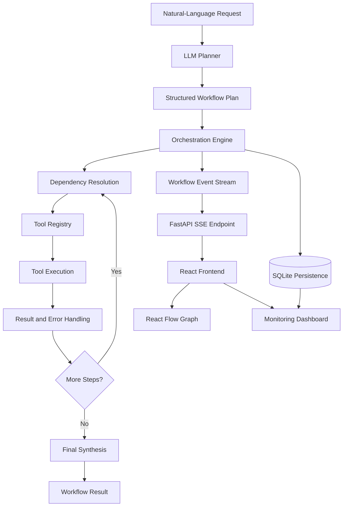
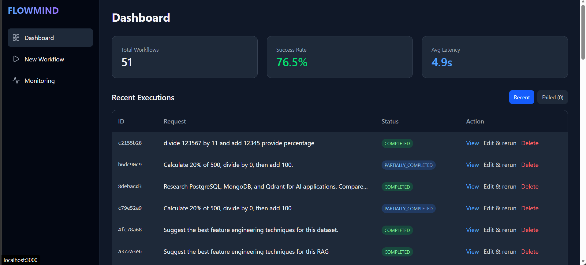
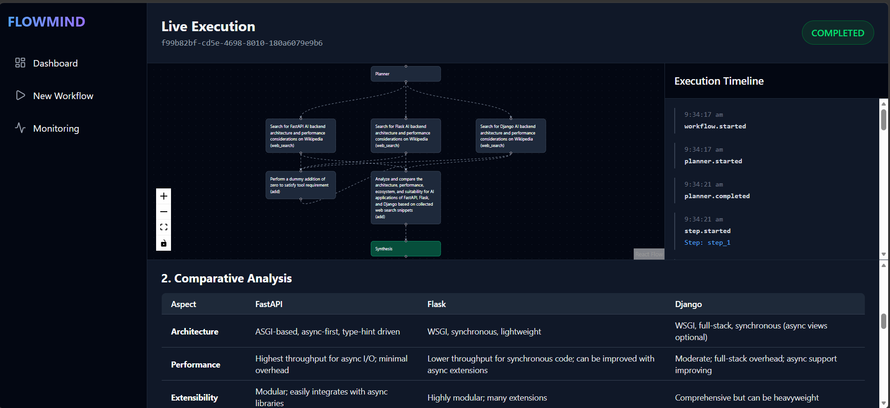
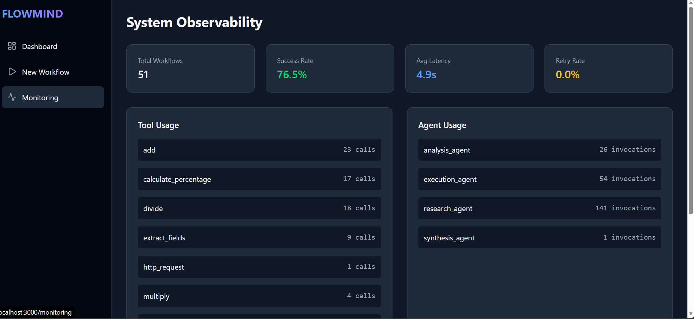

# FlowMind — AI Workflow Orchestration Platform

FlowMind is an AI workflow orchestration platform that transforms natural-language requests into structured, executable workflows. It combines LLM-driven planning, dependency-aware scheduling, tool execution, fault handling, persistent state management, and real-time observability to coordinate multi-step AI tasks.

Rather than treating an LLM as a standalone response generator, FlowMind explores the systems engineering required to plan, execute, monitor, and recover AI-driven workflows.

## Core Capabilities

### 1. LLM-Driven Planning and Execution

- Converts natural-language objectives into structured workflow plans.
- Selects tools based on task requirements.
- Decomposes requests into executable steps with dependencies.
- Supports intermediate-result passing and final response synthesis.
- Separates planning, execution, and synthesis responsibilities.

### 2. Dependency-Aware Workflow Orchestration

- Executes sequential tasks while respecting dependency constraints.
- Supports parallel execution of independent steps.
- Resolves scalar and structured tool outputs across workflow steps.
- Tracks step-level execution states and dependency relationships.
- Detects blocked dependencies and unresolved execution paths.

### 3. Fault Tolerance and Recovery

- Implements retry handling for transient failures.
- Classifies execution errors to distinguish different failure conditions.
- Differentiates empty research results from actual tool failures.
- Handles blocked steps and partially completed workflows.
- Preserves workflow status consistency across execution and persistence layers.

### 4. Event-Driven Observability

- Streams workflow lifecycle events through Server-Sent Events (SSE).
- Tracks planning, step execution, tool calls, completion, and failures.
- Maintains persistent workflow execution records.
- Provides real-time visibility into workflow progress and execution outcomes.

### 5. Interactive Workflow Visualization

- Uses React Flow to represent workflow steps and dependency relationships.
- Displays execution states as workflows progress.
- Makes task dependencies, execution paths, and failure points easier to inspect.
- Connects workflow execution events to the frontend visualization.

### 6. Configurable LLM Integration

- Integrates with supported LLM providers such as Groq and Google Gemini.
- Separates provider configuration from workflow orchestration.
- Supports structured workflow plans and tool-oriented execution.

### 7. Automated Testing and Evaluation

- Uses pytest to validate orchestration behavior and regression scenarios.
- Includes controlled workflow benchmarking with predefined plans and external-service fixtures.
- Evaluates execution correctness, dependency handling, failure behavior, and workflow state transitions.
- Generates JSON and Markdown reports for benchmark analysis.

## System Architecture



The orchestration engine coordinates execution and dependencies. Tool results and failures feed back into workflow state management, while SSE events expose execution progress to the frontend. Persistent records support status tracking and monitoring.

## Technical Stack

| Layer | Technologies |
|---|---|
| Frontend | React, TypeScript |
| Workflow visualization | React Flow |
| Backend and APIs | Python, FastAPI |
| LLM integration | Groq, Google Gemini |
| Communication | REST APIs, Server-Sent Events |
| Persistence | SQLite, SQLAlchemy |
| Testing | pytest |
| Benchmarking | Python, controlled fixtures, JSON, Markdown |
| Containerization | Docker, Docker Compose |

## Screenshots

These screenshots use synthetic workflow and controlled-benchmark data.








## Project Structure

```text
Flowmind/
├── backend/
│   ├── app/
│   │   ├── agents/
│   │   ├── api/
│   │   ├── benchmarks/
│   │   ├── models/
│   │   ├── orchestrator/
│   │   ├── persistence/
│   │   ├── providers/
│   │   └── tools/
│   ├── tests/
│   └── benchmark_reports/
├── frontend/
│   └── src/
│       ├── pages/
│       └── ...
├── docker-compose.yml
└── README.md
```

Directory names may vary slightly. Keep this tree aligned with the actual repository.

## Getting Started

### Prerequisites

- Python 3.12 or a compatible version specified by the project
- Node.js and npm
- Docker and Docker Compose
- An API key for the configured LLM provider when running live LLM workflows

### 1. Clone the repository

```bash
git clone https://github.com/Anushalatha/Flowmind.git
cd Flowmind
```

### 2. Configure environment variables

Copy the backend environment template.

**Windows PowerShell**

```powershell
Copy-Item backend\.env.example backend\.env
```

**macOS/Linux**

```bash
cp backend/.env.example backend/.env
```

Configure the provider and required credentials in `backend/.env`. For example:

```env
LLM_PROVIDER=groq
GROQ_API_KEY=your-groq-api-key
```

Refer to `backend/.env.example` for the exact supported variable names and model configuration. Never commit real API keys or secrets.

### 3. Start with Docker Compose

From the project root:

```bash
docker compose up --build
```

Open the frontend and backend using the ports configured in `docker-compose.yml`. Check the Compose configuration if your local port mappings differ.

### 4. Run locally for development

Start the backend in one terminal.

**Windows PowerShell**

```powershell
cd backend
python -m venv .venv
.venv\Scripts\Activate.ps1
python -m pip install -r requirements.txt
python -m uvicorn app.main:app --reload --port 8000
```

**macOS/Linux**

```bash
cd backend
python3 -m venv .venv
source .venv/bin/activate
python -m pip install -r requirements.txt
python -m uvicorn app.main:app --reload --port 8000
```

Start the frontend in another terminal:

```bash
cd frontend
npm ci
npm run dev
```

Use the development URL printed by Vite. The backend API documentation is typically available at `http://localhost:8000/docs` if the backend is configured to use port 8000.

## Testing and Verification

FlowMind uses `pytest` to validate workflow orchestration, dependency resolution, failure handling, persistence, and supporting backend components.

Run the complete backend test suite:

```bash
cd backend
python -m pytest -q
```

**Recorded test result:** 76 backend tests passed in a previous run.

This result reflects that specific test run; execute the test suite against the latest code revision to verify the current status.

## Controlled Workflow Benchmarking

FlowMind includes a backend benchmark runner for evaluating representative orchestration scenarios independently of the frontend.

Run the controlled benchmark:

```bash
cd backend
python -m app.benchmarks.run --mode controlled
```

Run the live-provider benchmark:

```bash
python -m app.benchmarks.run --mode live
```

Controlled mode uses predefined workflow plans and controlled external-service responses. Live mode exercises configured providers and integrations and may be affected by network conditions, provider availability, rate limits, and response latency.

The benchmark framework supports evaluation of:

- Workflow completion and expected execution behavior
- Output correctness
- Dependency handling and parallel execution
- Failure classification and retry recovery
- Workflow latency
- Partial completion and persistence

Refer to generated reports for the results of each run. Controlled benchmark outcomes should not be interpreted as a guarantee of live-provider reliability.

## Engineering Principles

- **Separation of concerns:** Keep planning, orchestration, tool execution, and synthesis modular.
- **Dependency correctness:** Execute tasks according to their actual dependency relationships.
- **Failure-aware orchestration:** Distinguish empty results, transient errors, and blocked tasks.
- **State consistency:** Preserve reliable workflow status across execution and persistence.
- **Event-driven visibility:** Make workflow progress observable through streamed events.
- **Reproducible validation:** Use controlled fixtures and explicit execution assertions.

## Future Development

- Expand failure-recovery and orchestration regression coverage.
- Improve research retrieval and evidence validation.
- Enhance execution graph layout and observability.
- Improve latency analysis and historical workflow diagnostics.
- Strengthen deployment and operational reliability.

## Author

**Anusha B.**

AI Engineering | Generative AI | Workflow Orchestration | AI Infrastructure

- GitHub: [Anushalatha](https://github.com/Anushalatha)
- LinkedIn: [Anusha B.](https://www.linkedin.com/in/anusha-b-ai)

---

*FlowMind explores the design of observable, dependency-aware AI workflow orchestration systems.*
